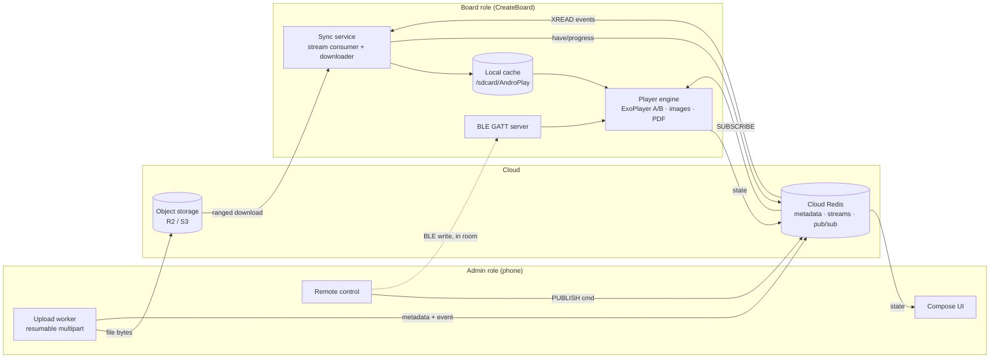

# Architecture

## Goals

1. **Zero-lag playback**: content is already on the board before anyone presses play.
2. **Hands-free control**: phone, Bluetooth remote, or remotely over the internet.
3. **Seamless sync**: upload once from any admin device; every board gets it automatically, even if it was offline.
4. **Light**: one small APK, no heavy frameworks, and the board does nothing except play.

## System overview

## Why Redis plus object storage

Redis is ideal for small, hot, real-time data: metadata, sync events, commands and live state. It is not built for multi-GB video blobs, because memory is expensive and cloud Redis plans cap request and value sizes. So:

| Data | Lives in | Why |
|---|---|---|
| Content metadata, sync status, playlists | Redis hashes/sets | Fast reads, atomic updates |
| "Content added/removed" events | **Redis Stream** `ap:events` | Durable, so an offline board resumes from its last-read id |
| Play/pause/seek commands | Redis **pub/sub** per board | Fire-and-forget, lowest latency |
| Live playback state | Redis key + pub/sub | Admins see position/status live |
| File bytes | **S3-compatible bucket** (Cloudflare R2 default: free egress) | Cheap, resumable multipart, ranged GET |
| Playback copy | Board local storage | Plays instantly with no network dependency |

## Roles (single APK)

On first launch the app asks **Board** or **Admin** and remembers it. A board can be locked into Board mode (kiosk).

### Board role
- **SyncService** (foreground): keeps a TLS connection to Redis, consumes `ap:events` with `XREAD BLOCK`, and runs a heartbeat (`SET ap:board:{id}:online EX 15`).
- **Downloader**: one file at a time, HTTP Range resume into `.part` files. It verifies the fingerprint, moves the file into `/sdcard/AndroPlay/<Type>/`, then `SADD ap:board:{id}:have <contentId>`.
- **Local indexer**: files already on the board (USB, Movies, Downloads…) are fingerprinted and registered with `origin=board`, so admins can play them too.
- **PlayerEngine**: two ExoPlayers (active + standby with the next item prepared). Images are decoded to screen size and PDF pages pre-rendered with `PdfRenderer`. Office docs open in the board's viewer app.
- **Command intake**: Redis `SUBSCRIBE ap:board:{id}:cmd`, the BLE GATT server and HID key events. All of them feed one `dispatch(Command)`.

### Admin role
- Library grid by type, with per-board badges: *Queued · Uploading 42% · Downloading on board 70% · Ready*.
- Add content from the picker or **Share → AndroPlay**. Uploads are queued in WorkManager and resume after drops.
- Board picker shows online/offline from heartbeats. The remote bar has play/pause, seek, prev/next, volume, PDF page and stop.
- Commands go over BLE when the board is in range, and over Redis pub/sub otherwise.

## Redis key schema

Prefix `ap:` (configurable, so several labs can share one Redis).

| Key | Type | Contents |
|---|---|---|
| `ap:content` | ZSET | contentId → addedAt |
| `ap:content:{id}` | HASH | name, type, mime, size, objectKey, origin, addedBy, addedAt, status (`uploading`/`ready`) |
| `ap:events` | STREAM | `{op: add\|remove\|update, id}`; trimmed `MAXLEN ~10000` |
| `ap:shows` | HASH | slideshowId → JSON `{name, items[contentId…], imageSeconds, loop}`; changes emit `op=show` on `ap:events` |
| `ap:boards` | SET | board ids |
| `ap:board:{b}` | HASH | name, model, ip, appVersion, freeBytes, lastSeen |
| `ap:board:{b}:online` | STRING (TTL 15 s) | heartbeat |
| `ap:board:{b}:have` | SET | content ids fully downloaded |
| `ap:board:{b}:progress` | HASH | contentId → bytes downloaded |
| `ap:board:{b}:cursor` | STRING | last processed stream id |
| `ap:board:{b}:queue` | LIST | current presentation order |
| `ap:board:{b}:state` | STRING | latest playback state (JSON) |
| `ap:board:{b}:cmd` | channel | binary commands (base64), board subscribes |
| `ap:board:{b}:state` | channel | state updates, admins subscribe |

Content id = **fingerprint**: SHA-256 of (size, first 1 MiB, last 1 MiB), truncated to 128 bits. It identifies a multi-GB file instantly, and the same file uploaded twice dedupes automatically.

## Flows

### Upload → board ready
1. Admin picks a file. The app computes the fingerprint, `HSET ap:content:{id} … status=uploading` and enqueues the upload.
2. Multipart upload to `content/{id}/{name}` with resume via a saved uploadId and parts.
3. On completion: `HSET status=ready`, `ZADD ap:content`, `XADD ap:events op=add id=…`.
4. Every board's `XREAD` wakes up and downloads with ranged GETs, updating `progress`. After verification it runs `SADD have`.
5. The admin UI shows "Ready on Board-1".

### Board offline
The board stores its stream cursor. On reconnect it runs `XREAD` from the cursor, then reconciles `ZRANGE ap:content` against `have`, so missed events or a trimmed stream can't lose content.

### Play
Admin taps an item → `SetQueue` (once) + `Play(handle)`.
- In the room: BLE write-without-response, about 10–30 ms.
- Remote: `PUBLISH ap:board:{b}:cmd`, about 20–60 ms depending on the Redis region.

Either way the board swaps to the preloaded player or starts the local file in 150–300 ms.

## Latency budget (target)

| Step | Time |
|---|---|
| Command, BLE | 10–30 ms |
| Command, Redis pub/sub (same region) | 20–60 ms |
| Start preloaded item | < 50 ms |
| Start cold local file | 150–300 ms |
| Upload → visible on boards | ~1 s after the upload completes, plus download time |

## Security (v1 vs. later)

- v1: the Redis URL and storage keys are provisioned once per device (app-private SharedPreferences, via the setup screen, a shareable setup code, or adb). TLS is used everywhere (`rediss://`, HTTPS). Fine for a closed set of lab devices.
- Later: a small auth API issuing per-device Redis ACL users and presigned storage URLs, so no master credentials live on phones.

## Shared protocol module

`protocol/` is pure Kotlin and unit-tested: content types, MIME map, the binary `Command` codec (shared by BLE and Redis), `PlaybackState` (20 bytes, one BLE notification), and `Fingerprint`.
